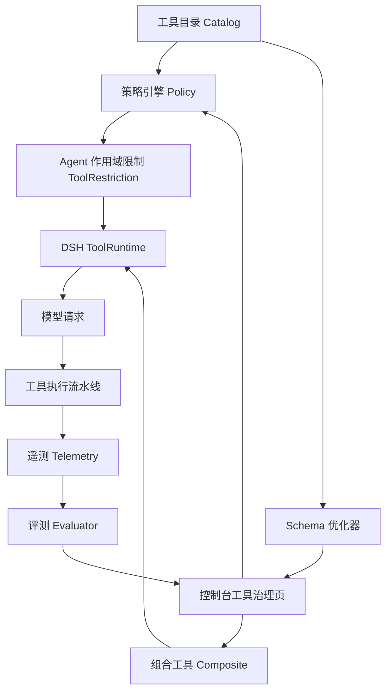

# 工具治理与组合优化设计

> 状态：M1/M2 生产化补强完成；M3 检索层 golden task A/B 已实现；待模型端到端 A/B 与用户批准上线
>
> 目标插件：`@noob-stupid/dsh-plugin-console`
>
> 当前插件版本：`0.5.116`（工具治理尚未并入发布版本）
>
> 本地宿主运行时：`@deepseek-ai/dsh-tools 0.2.0-rc.2`
>
> 日期：2026-11-28

## 0. 生产化补强（2026-11-28）

在 M1/M2 原实现上补了以下生产项：

- **小目录自动跳过**：`minCatalogTools` 默认 10；工具数低于阈值时不加 restriction，避免为很少的工具增加 search/activate 往返。UI 显示“已跳过限制”。
- **相关性硬过滤**：`selectActiveTools` 只收任务正分工具，不再用零分工具按字母序填满上限；无任务文本时只保留 baseline + 治理工具。
- **CI 门禁**：`test-tool-governance`、`-scale`、`-bench`、`-composite`、`-ui` 已加入 `test.yml`；真实 host 80 工具测试仍为本地可选（CI 无 host package 时显式 SKIP）。
- **确定性 Schema 成本基准**：`test-tool-governance-bench.mjs` 用 80 个带 6 个参数的合成工具测得：
  - 80 tools 总 Schema 35,440B；
  - active 6 tools 2,658B；
  - 降幅 **92.5%**。
  这是“发送给模型的 Schema 字节”代理指标，不是模型准确率/A-B 结论。
- **仍未完成**：模型端到端 A/B、rc.5 真实 Agent 复测、原生配置卡的 live UI 验收。

### 0.2 真实模型工具选择 A/B（2026-11-28，首轮）

用真实 DeepSeek 模型 + 6 个小任务（硬件沙盒 / OpenViking 记忆 / 仓库搜索 / Web 搜索）对比“全部 24 个工具”与“治理后 active 集合 + search/activate”：

| 指标 | baseline | governed |
|---|---:|---:|
| 任务成功 | 6/6 | 5/6 |
| prompt tokens | 10,359 | 5,354（-48.3%） |

结论：

- 首轮真实模型评测**没有显示能力上升**，反而少成功 1 个；这与预期一致，治理首先省的是 Schema/token，不是自动变聪明；
- 唯一失败是 `hw-run`：baseline 4 步完成，governed 需要 search/activate，5 步内没到 `hw_run_simulation`，属于**多步开销**；
- 已做的迭代：补中文意图别名、把 `read/write/edit/glob/grep/bash/web_search/web_fetch` 等原生工具设为 protected（始终可见，不占第三方 active 名额）；
- 下一步应增加步预算/更主动的初始选择/结果反馈排序，再重跑同一组任务；不能拿这轮 5/6 宣称“更智能”。

评测脚本：`scripts/eval-tool-governance-model.mjs`；结果：`docs/tool-governance-model-eval.json`。

### 0.1 M3 检索层评测（2026-11-28）

- `agent/evaluator.js`：10 条 golden task，比较“全部工具（baseline）”与“治理后的 active 集合”；
- 指标：recall@active、precision、平均 active 数、Schema 字节降幅；
- 结果：recall **1.000**、平均 active **8.4**、Schema **35,440B → 3,721B（-89.5%）**；
- 路由：`GET/POST /plugin-console/tool-governance/evaluation`；
- UI：`[tool govern]` 里的“运行评测”按钮；
- **边界**：这是检索层评测，不调用模型；模型端到端成功率仍需真实会话 A/B，因此不能宣称“更聪明”已证。

## 1. 产品目标

为插件控制台增加一套 **Harness 工具治理与组合优化层**，解决第三方插件和 MCP 工具越装越多后出现的：

- 工具 Schema 挤占上下文，首轮请求成本持续上升；
- 工具名称和描述语义重叠，模型选错工具；
- 参数 Schema 质量参差不齐，调用后才发现参数不可用；
- 高频跨工具流程需要模型反复编排，步骤多、容易断；
- 缺少工具选择、参数错误、执行失败和上下文成本的数据。

核心产品承诺：

> 用户仍然可以安装所有需要的工具，但模型每个步骤只看到当前最相关的一组工具；找不到时可以搜索并按需加载；稳定流程可以组合成受控的宏工具；所有变化可观测、可评测、可回滚。

这不是简单增加几个“控制台专用 Agent 工具”，而是给现有控制台增加一个新的产品域：**工具目录、策略、运行时、组合、遥测和评测**。

## 2. 非目标

以下内容不在首版范围内：

- 不修改 DSH Agent Loop 或 `dsh-tools` 内核；
- 不重写第三方工具的执行逻辑；
- 不把工具过滤当作安全沙箱或权限提升机制；
- 不在首版自动改写参数 Schema 的语义；
- 不默认让 LLM 参与每次工具路由，避免额外延迟和费用；
- 不执行用户提供的任意脚本或命令来定义组合流程。

## 3. 现状与宿主约束

### 3.1 插件现状

- 插件入口只注入 `webServer` 和 `loader`：`lib/index.js:70`。
- 当前主要能力是 HTTP 管理路由，不是 Agent 工具提供方。
- 路由表约有 79 个入口：`lib/server/routes/index.js:56`、`lib/server/routes/index.js:152`。
- “AI 赋能”借用通用子代理，没有专属工具集：`lib/server/domain/ai-run.js:144`。
- 架构护栏要求：
  - `lib/index.js` 不超过 142 行：`tests/test-architecture-guard.mjs:98`；
  - `lib/server/**` 单文件不超过 600 行：`tests/test-architecture-guard.mjs:115`；
  - 可选宿主服务使用 `ctx.get('name')`，不要直接读取未声明属性：`tests/test-architecture-guard.mjs:307`。

### 3.2 宿主已具备的扩展点

本地宿主源码工作树中的 `packages/core/tools`、`packages/core/agent`、`packages/core/system-prompt` 当前显示为删除。本设计没有恢复或修改这些文件，证据来自 Git HEAD、已有文档和已安装运行时。

关键事实：

1. **工具注册与查询**
   - `ctx.tools.register(definition)` 注册工具：`packages/core/tools/src/index.ts:1037`。
   - `ctx.tools.schemas(scope?)` 返回某作用域可见的模型 Schema：`packages/core/tools/src/index.ts:1234`。
   - `ctx.tools.get(name, scope?)` 返回可见定义：`packages/core/tools/src/index.ts:1204`。

2. **动态工具过滤已有正规机制**
   - `ctx.tools.restrict({ allow, deny })` 在 Agent 作用域内过滤继承工具：`packages/core/tools/src/index.ts:1071`。
   - 同一个解析器同时约束 Schema 展示、工具查找和执行：`packages/core/tools/src/index.ts:1152`。
   - 官方扩展指南明确把“替换 scoped restriction”列为 ToolSearch / progressive disclosure 的实现方式：`docs/cookbook/extension-cookbook.md:113`。
   - 限制只能收窄可见性，不能覆盖其他插件或宿主的权限策略。

3. **执行流水线可观测**
   - `tools/pre-execute`：允许、拒绝、请求审批：`packages/core/tools/src/index.ts:1475`。
   - `tools/execute`：包裹真实执行，可测耗时：`packages/core/tools/src/index.ts:1573`。
   - `tools/post-execute`：转换或阻止结果：`packages/core/tools/src/index.ts:1742`。
   - `tools/result`：观察不可变最终结果：`packages/core/tools/src/index.ts:1657`。
   - `tools/change`：工具注册、注销或限制变化：`packages/core/tools/src/index.ts:199`。

4. **模型选择失败可从会话日志还原**
   - Agent Loop 在执行前记录 `tool/call`，包含模型原始工具名和参数：`packages/core/agent-loop/src/tool-calls.ts:262`。
   - `tool/result` 记录错误身份：`docs/subsystems/session.md:82`。
   - `request/header` 保存每轮实际发送的工具 Schema：`docs/subsystems/session.md:154`。

5. **MCP 工具已经统一进入 ToolRuntime**
   - MCP 工具使用 `mcp__<server>__<tool>` 名称注册：`packages/mcp/mcp-client/src/tools.ts:96`。
   - 支持整世代替换和失败回滚：`packages/mcp/mcp-client/src/tools.ts:128`。
   - 因此治理层不需要分别适配每个 MCP Server， catalog 可以直接从 ToolRuntime 获取。

### 3.3 重要边界

- `ToolRestriction` 的 allow-list 只能引用当前可限制的继承工具；名称不存在时会报错。
- 作用域自身注册的工具不受 restriction 过滤，适合放置治理工具自身。
- 多个 restriction 取交集，治理层只能进一步收窄，不能放宽其他策略。
- 工具来源没有强元数据。MCP 来源可从命名空间识别，普通插件工具只能记录“未知/推断来源”。
- 工具过滤不是安全边界；真正的写权限、审批和沙箱仍由宿主工具和策略负责。

## 4. 用户场景

### 场景 A：工具很多，但当前任务很简单

用户安装了 80 个工具，让 Agent 修改一个 README。

期望：

1. 治理层自动暴露文件读取、编辑、搜索等基础工具；
2. 浏览器、数据库、Office 等无关工具不进入本轮 Schema；
3. 模型仍可通过 `plugin_console_tool_search` 找到隐藏工具；
4. 控制台显示本轮工具数、Schema 字节数和被隐藏工具。

### 场景 B：模型选择了错误工具

用户让 Agent 查询 GitHub Issue，模型却调用了一个泛化的 `search` 工具。

期望：

1. 会话日志记录实际选择和错误结果；
2. 控制台指出两个工具的描述重叠；
3. 用户可以固定首选工具、隐藏另一个，或生成描述优化建议；
4. 变更只影响后续请求，可立即回滚。

### 场景 C：高频跨工具流程

用户经常执行“查 Issue → 拉取评论 → 总结 → 写入文档”。

期望：

1. 用户定义一个声明式 composite tool；
2. 工具声明依赖、参数映射、并行关系和确认点；
3. 执行时仍通过 `ctx.tools.execute()` 走原生审批、guard 和结果日志；
4. 任何子步骤失败都有明确结果，不静默继续。

### 场景 D：没有工具服务或宿主版本不支持

控制台仍能正常管理插件，但“工具治理”页明确显示“当前宿主不支持”，不能假装优化已生效。

## 5. 总体架构



### 5.1 模块边界

建议新增以下模块，均放在 `lib/server/**`，避免入口文件增长：

| 模块 | 职责 |
|---|---|
| `agent/catalog.js` | 从 ToolRuntime 获取工具，生成目录、来源推断、Schema 统计和冲突候选 |
| `agent/policy.js` | 纯策略计算：基线工具、任务特征、候选评分、活跃集合、降级集合 |
| `agent/runtime.js` | 安装/移除 restriction、处理 Agent 生命周期和 `tools/change` |
| `agent/schema-optimizer.js` | 生成描述压缩和 Schema 问题报告；首版只在线应用描述层优化 |
| `agent/telemetry.js` | 采集曝光、选择、执行、结果、耗时和上下文成本 |
| `agent/evaluator.js` | 运行 golden tasks、策略对比和回归检查 |
| `agent/composite.js` | 声明式组合工具注册与嵌套执行 |
| `domain/tool-governance-store.js` | 配置、目录快照、评测结果和审计记录的持久化 |
| `routes/tool-governance.js` | HTTP 路由，复用现有安全中间件 |

### 5.2 功能开关与装载方式

工具治理**不新增独立子插件，不新增 bundle 行，也不改 `cordis.patch.yml`**。它作为主控制台内部的可选功能模块运行：

- 主控制台启动时通过 `ctx.get('tools')` 和 `ctx.get('agents')` 可选获取宿主能力；
- 配置默认 `enabled: true`；
- 右侧 **“功能包”** 菜单新增按钮 **`[tool govern]`**；
- 点击按钮进入工具治理页面；
- 页面内提供“启用治理 / 停用治理”开关；
- 停用只释放治理运行时、工具注册和 restriction，恢复宿主原始工具视图；
- 重新开启时重新读取目录并应用策略，无需重启服务；
- 没有工具服务时按钮仍显示，但页面明确提示当前宿主不支持。

原因：

- 保持主控制台现有 bundle 形态不变；
- 不增加插件列表中的额外条目；
- 用户熟悉的“功能包”菜单就是统一开关入口；
- 没有工具服务的宿主不会被拖住；
- 开关是主控制台内部功能，不涉及第三方工具安装或卸载。

## 6. 工具目录

### 6.1 目录条目

每个工具至少记录：

```text
name
description
parameters
outputSchemaSummary
sourceKind        native | mcp | unknown
sourceHint        mcp server name / inferred package / null
schemaBytes
riskHints         read | write | network | process | unknown
firstSeenAt
lastSeenAt
enabledInCatalog
userTags
```

### 6.2 获取方式

- 全局目录：`ctx.tools.schemas()`；
- Agent 目录：`ctx.tools.schemas(agent)`；
- 单个定义：`ctx.tools.get(name, agent)`；
- 监听 `tools/change` 刷新目录；
- 对已存在的 Agent，在治理运行时启动时补齐作用域状态。

### 6.3 冲突检测

首版使用确定性规则，不调用 LLM：

- 名称归一后相同；
- 描述余弦相似度过高；
- 参数名称和类型高度重合；
- 同名前缀但来源不同；
- 一个工具描述包含另一个工具的全部关键动作词；
- MCP 不同 server 暴露同名 raw tool。

输出“冲突候选”而不是自动禁用，避免误判。

## 7. 动态工具暴露

### 7.1 活跃集合

每个 Agent 维护：

```text
baselineTools      用户固定的基础工具
activeTools        当前模型可见工具
recentTools        最近成功使用的工具
pinnedTools        用户手动固定的工具
hiddenTools        用户明确隐藏的工具
compositeDeps      已选组合工具的依赖
```

计算规则：

```text
active = baseline
      ∪ pinned
      ∪ activated
      ∪ recent
      ∪ topK(taskRelevant)
      - hidden
      ∩ hostVisible
```

`maxActiveTools` 是硬上限；治理工具始终保留，超出上限的激活请求进入 `deferred`，不会破坏上下文预算。

其中 `hostVisible` 是 ToolRuntime 当前可见集合，保证治理层不会绕过宿主已有 restriction。

### 7.2 路由方式

首版默认使用确定性规则：

- 用户消息关键词；
- 当前工作区文件类型；
- 最近使用的工具；
- 用户固定规则；
- 当前 composite 依赖；
- 可选的本机 embedding，后续再引入。

路由失败时回退到 `baselineTools`，不能回退为“全部暴露”。

### 7.3 搜索与按需加载

新增两个治理工具，使用插件专属命名空间，避免与宿主或第三方工具重名：

- `plugin_console_tool_search(query, limit?)`
  - 搜索完整目录，而不是当前可见集合；
  - 返回紧凑摘要：名称、用途、来源、风险、Schema 大小；
  - 不返回完整参数 Schema，避免二次上下文膨胀。
- `plugin_console_tool_activate(names)`
  - 将工具加入当前 Agent 的下一轮活跃集合；
  - 返回“将在下一步生效”；
  - 不允许激活用户明确隐藏或宿主不可见的工具；
  - 超过最大活跃工具数时返回 `deferred`，不会无限撑大 Schema。

这两个工具应放在 Agent 自身作用域或始终包含在 allow-list 中，避免被自己的 restriction 隐藏。

### 7.6 工具命名与冲突处理

- 治理工具统一使用 `plugin_console_` 前缀；
- composite 工具同样使用 `plugin_console_` 前缀；
- 注册前调用 `ctx.tools.get(name)` 和 `ctx.tools.schemas()` 检查同名工具；
- 如果命名冲突：
  - 不覆盖已有工具；
  - 不自动加后缀导致模型难以理解；
  - 治理功能进入可见的降级状态，并在原生 UI 中说明冲突名称；
  - 其他治理能力继续可用。

### 7.4 应用 restriction

- 在 `agent.ctx` 上调用 `tools.restrict({ allow: activeNames })`；
- 保存精确 disposer；
- 集合变化时先移除旧 restriction，再注册新 restriction；
- `tools/change` 导致名称失效时，重新计算并记录原因；
- 治理停用或 Agent 销毁时释放所有 restriction。

### 7.5 执行一致性

只改模型可见 Schema 而不改执行是不允许的。首版采用：

- 动态过滤：`ctx.tools.restrict()`；
- 描述优化：`system-prompt/assemble` 的专家瀑布，只改描述文本；
- 参数 Schema：首版只生成问题报告和优化预览，不在线改变语义。

这样模型看到和执行校验使用的是同一套工具集合，同时避免“Schema 说可选、执行却要求必填”的不一致。

## 8. Schema 优化

### 8.1 离线分析

对每个工具检查：

- 描述过长、重复、缺乏使用时机；
- 参数缺少说明；
- `enum` 实际写成字符串；
- `required` / `optional` 混淆；
- 过深嵌套；
- 未声明 `additionalProperties`；
- 输出 Schema 与渲染内容不一致；
- 名称过长或语义含糊。

### 8.2 在线应用等级

| 等级 | 内容 | 首版 |
|---|---|---|
| L0 | 只读报告 | 是 |
| L1 | 压缩重复描述、补充固定格式的使用提示 | 是，可开关 |
| L2 | 参数重命名、默认值、结构重组 | 否，需要适配层 |
| L3 | 自动合并多个工具 | 否，属于 composite |

L1 只修改模型可见描述，不修改 `ToolDefinition.parameters`，因此不会破坏原工具校验。

### 8.3 优化预览

页面展示：

- 原始描述；
- 建议描述；
- 原始/建议 Schema 字节数；
- 可能受影响的工具；
- 一键应用、撤销和恢复默认。

## 9. 组合工具

### 9.1 首版格式

使用声明式 JSON，不使用任意代码：

```json
{
  "name": "github_issue_to_doc",
  "description": "读取 Issue 和评论，生成摘要并写入指定文档",
  "inputs": {
    "issue": "string",
    "outputPath": "string"
  },
  "steps": [
    { "tool": "mcp__github__get_issue", "args": { "number": "${issue}" } },
    { "tool": "mcp__github__list_comments", "args": { "number": "${issue}" } },
    { "tool": "write", "args": { "path": "${outputPath}", "content": "${summary}" } }
  ],
  "confirmation": "write"
}
```

最终字段以实现评审为准。

### 9.2 执行规则

- 只允许引用目录中存在且当前 Agent 可见的工具；
- 嵌套调用使用 `ctx.tools.execute()`；
- 传递父执行 token、根 call id、Agent 和取消信号；
- 不直接调用 `tool.execute()`，避免绕过审批和 guard；
- 并行步骤只允许宿主判定为 concurrency-safe 的调用；
- 任一关键步骤失败即停止，并返回结构化部分结果；
- 用户确认点不能由模型自行绕过。

### 9.3 后续扩展

- 从会话中半自动推荐 composite；
- 从 Code Mode 程序提炼宏；
- 子代理委派作为组合步骤；
- 组合版本化、灰度和回滚。

## 10. 遥测与评测

### 10.1 数据来源

| 信号 | 来源 |
|---|---|
| 工具全集与 Schema 大小 | catalog / `request/header` |
| 每轮曝光工具集合 | restriction 更新 / `request/header` |
| 模型选择了什么 | `tool/call` |
| 是否被策略拒绝 | `tools/pre-execute` / `tools/result` |
| 执行耗时 | `tools/execute` |
| 最终成功或失败 | `tools/result` |
| 参数错误 | `INVALID_ARGS` |
| 未知工具 | `UNKNOWN_TOOL` |
| 输出过大 | 结果字节数 / spill 信息 |
| 任务是否完成 | `turn/end` / golden task 结果 |

### 10.2 默认不记录

- API key、token、cookie；
- 完整工具参数；
- 完整工具输出；
- 文件正文；
- 用户消息原文。

默认只记录名称、哈希、长度、时间、错误码和聚合统计。详细捕获必须显式开启并提示隐私风险。

### 10.3 存储

建议目录：

```text
<DSH_HOME>/plugin-console/tool-governance/
  config.json
  catalog.json
  events.jsonl          // tool-governance-events.jsonl
  evaluations.json
  audit.jsonl
```

要求：

- 原子写入；
- 事件文件滚动和大小上限；
- 损坏文件不阻塞插件启动；
- 配置修改记录审计日志；
- 支持一键导出脱敏评测报告。

### 10.4 Golden tasks

首版至少覆盖：

1. 列出当前插件状态；
2. 搜索记忆类插件；
3. 查询一个安装任务；
4. 从 80 个工具中找到浏览器工具；
5. 调用被隐藏工具应被拒绝；
6. 搜索并激活隐藏工具后下一步可调用；
7. composite 子步骤失败时正确停止；
8. 治理停用后恢复原工具视图。

### 10.5 反馈驱动的描述更新（P1，未实现）

已有 `buildSchemaReport` + `descriptionOverrides` + schema workshop，但只支持**人工预览/应用**。
后续补闭环：

```text
telemetry 的误选/失败/参数错误
  → 聚合到具体工具
  → 生成“原文 vs 建议”的描述修改提案
  → 用户在 workshop 预览
  → 确认后写入版本化 descriptionOverrides
  → golden task / 真实模型 A/B 验证
  → 无改善则一键回滚
```

安全边界：只改治理层有效描述，不改第三方包；不改参数 Schema 语义；不自动应用；证据不足不提示。
接口预留：`GET/POST /tool-governance/description-proposals`；数据结构包含 `tool/current/proposed/evidence/status/version`。

### 10.6 成功指标

目标值，不是当前实测：

- 50+ 工具场景下，单轮 Schema 字节数下降至少 50%；
- 隐藏工具直接调用拒绝率 100%；
- 搜索/激活恢复任务成功率至少 90%；
- 治理策略计算 p95 开销低于 20ms；
- 不降低 golden task 的基础完成率；
- 遥测默认零敏感字段泄漏。

## 11. DSH 原生 UI 集成

不自建独立面板，不注入自定义 DOM。UI 分三层：

1. **功能开关**
   - 右侧“功能包”菜单按钮：`[tool govern]`；
   - 默认开启；
   - 点击切换治理功能；
   - 与“门控”“框架”“技能”等现有功能项并列。

2. **原生配置卡片**
   - 复用官方插件管理页的 `plugins.bundle.config` 插槽；
   - 以 `@noob-stupid/dsh-plugin-console` 为 key 注册原生配置卡片；
   - 展示工具目录、当前活跃集合、Schema 变化、遥测摘要和策略配置；
   - 沿用官方容器、样式和设置交互；
   - 老宿主没有该插槽时安全降级，不影响开关。

3. **原生工具卡片**
   - 治理工具通过 `presentCall` / `presentResult` 提供原生工具卡片数据；
   - 搜索结果、激活结果和错误信息由 DSH 原生工具 UI 渲染；
   - 不额外实现聊天消息 DOM 或自定义弹窗。

### 11.1 概览

- 工具总数；
- 当前平均活跃工具数；
- Schema 字节数变化；
- 未知工具调用数；
- 参数错误率；
- 执行失败率；
- 最近策略变更。

### 11.2 工具目录

- 搜索、来源筛选、风险筛选；
- Schema 大小排序；
- 冲突候选标记；
- 固定、隐藏、编辑标签；
- 查看原始与优化描述；
- 查看最近调用结果。

### 11.3 当前会话

- 当前 Agent；
- 活跃工具与隐藏工具；
- 最近 `plugin_console_tool_search` / `plugin_console_tool_activate`；
- 最近失败调用；
- 手动调整活跃集合。

### 11.4 策略配置

- 基础工具；
- 最大活跃工具数；
- 路由模式；
- 描述优化开关；
- 是否治理子 Agent；
- 遥测详细程度；
- 配置导出、导入、恢复默认。

### 11.5 组合工具

- 列表与版本；
- 依赖工具检查；
- 确认点配置；
-  dry-run；
- 执行记录与失败步骤。

### 11.6 评测

- Golden task 列表；
- 运行评测；
- 策略前后对比；
- 失败样本；
- 灰度发布与回滚。

## 12. HTTP 接口

新增路由必须同步更新 `tests/test-route-inventory.mjs`。

建议：

```text
GET  /plugin-console/tool-governance/state
POST /plugin-console/tool-governance/config
POST /plugin-console/tool-governance/preview
POST /plugin-console/tool-governance/catalog-action
POST /plugin-console/tool-governance/composites
POST /plugin-console/tool-governance/evaluate
POST /plugin-console/tool-governance/rollback
```

所有路由继续复用现有：

- 环回地址校验；
- Host 校验；
- 同源写保护；
- 方法守卫；
- 统一错误响应。

## 13. 安全与失败处理

### 13.1 安全原则

- 治理层只能收窄工具可见性，不能授予新权限；
- 不直接调用工具定义中的 `execute()`；
- composite 的每个子调用重新走宿主执行流水线；
- 危险动作保留宿主审批，不在治理层伪造“已确认”；
- 配置写入需要明确确认和审计；
- 默认脱敏遥测；
- 用户隐藏优先于自动推荐；
- 不停用、不卸载、不修改第三方工具本身。

### 13.2 失败策略

| 失败 | 行为 |
|---|---|
| 宿主没有 `tools.restrict` | 治理运行时禁用，页面显示不支持 |
| 目录读取失败 | 保留上一份目录，显示过期状态 |
| 路由计算失败 | 使用 baselineTools |
| restriction 注册失败 | 保留旧 restriction，不上报成功 |
| 工具名失效 | 从活跃集合移除并记录原因 |
| 遥测写入失败 | 不影响工具执行 |
| Schema 优化异常 | 使用原始描述 |
| composite 依赖不可见 | 拒绝执行并指出缺失工具 |

## 14. 分阶段交付

### M1：可用治理闭环

交付形态：主控制台内部可选功能，**默认开启**；右侧“功能包”菜单提供 **`[tool govern]`** 开关。详细 UI 使用 DSH 原生 `plugins.bundle.config` 插槽和原生工具卡片，不自建面板。不新增子插件，不新增 bundle 行。

必须交付：

- 工具目录；
- Agent 作用域动态 restriction；
- `plugin_console_tool_search` / `plugin_console_tool_activate`；
- 描述压缩；
- 基础遥测；
- 工具治理概览页；
- 80 工具夹具下的可见性和执行一致性测试。

M1 的签名效果必须是：

> 80 个工具进入目录，模型当前只看到约 10 个；模型搜索并激活一个隐藏工具后，下一步能正常调用；直接强行调用未激活工具会被宿主拒绝。

### M2：组合与优化工作室（已实现）

- 冲突检测；
- Schema 问题报告；
- 优化预览与应用；
- 声明式 composite；
- 并行与确认点；
- 组合执行记录。

### M3：评测、灰度与高级路由

- Golden task 自动化；
- 策略 A/B；
- 灰度发布；
- 一键回滚；
- 本地 embedding 路由；
- 子 Agent 治理策略；
- 从会话推荐 composite。

### M4：能力契约与插件调度（未实现，方向已确认）

用户目标不是“少暴露工具”，而是插件能力之间的调度/交接。M4 需要：

- 能力契约：`inputs/outputs/sideEffects/cost/requires/produces`；
- 任务 DAG：节点是能力，不是工具名；
- 调度：并行、预算、超时、重试、降级；
- 交接：artifact 或 peer session，不靠模型猜输出；
- 多插件端到端评测：成功率、墙钟、轮数、handoff 失败率。

在 M4 之前，M1/M2 的 catalog/restriction/composite 只作为底座，不作为最终卖点。

## 15. 测试计划

### 15.1 单元测试

- 目录去重、来源推断、Schema 统计；
- 冲突检测；
- 活跃集合计算；
- 用户固定/隐藏优先级；
- 描述压缩不改变参数 Schema；
- 配置校验；
- 遥测脱敏、轮转和损坏文件恢复；
- composite 参数映射与失败停止。

### 15.2 ToolRuntime 集成测试

使用真实 `ToolRuntime` 和测试 Agent：

- 注册 80 个工具；
- restriction 后只返回活跃工具；
- 隐藏工具直接执行被拒绝；
- `plugin_console_tool_activate` 后下一步可见；
- `tools/change` 后限制自动修复；
- 治理 disposer 恢复完整视图；
- 与已有 restriction 取交集；
- Code Mode 下不能绕过限制。

### 15.3 插件回归测试

- `test-architecture-guard.mjs`；
- `test-route-inventory.mjs`；
- `test-harness.mjs`；
- strict-ctx 测试；
- 无工具服务时主控制台仍可启动；
- 功能开关停用与重新开启；
- UI 空状态、错误状态、配置保存和回滚。

### 15.4 端到端验收

- 通过 Loader 启动真实组合；
- 记录模型可见工具集合；
- 验证 `request/header` 中的工具 Schema 与治理状态一致；
- 验证 `tool/call` / `tool/result` 可完整还原；
- 使用 golden tasks 比较治理前后成功率和上下文成本。

## 16. 风险与缓解

| 风险 | 缓解 |
|---|---|
| 路由错误隐藏了必要工具 | baseline + recent + search/activate 恢复通道 |
| 描述优化改变模型理解 | 首版只做压缩和固定提示，参数语义不变 |
| restriction 与其他插件冲突 | 只取交集，不替代宿主策略 |
| 工具频繁变化导致限制失效 | `tools/change` 重新计算并保留旧状态 |
| 治理开销拖慢每轮请求 | 纯本地规则、缓存目录、限制计算频率 |
| composite 绕过审批 | 只走 `ctx.tools.execute()`，禁止直接执行定义 |
| 遥测泄露敏感信息 | 默认脱敏、明确开关、大小上限 |
| Agent 作用域内自有工具绕过上限 | 宿主 restriction 只过滤继承工具；检测并显示 `capEnforced=false` 警告，不假装硬限制生效 |
| Code Mode 描述覆盖不生效 | 原生 UI 明确提示；描述覆盖目前只在原生工具模式下生效 |
| 组合工具依赖超出活跃上限 | 只在组合工具被固定/激活/动态选中时预留依赖槽位；放不下则不暴露该组合工具 |
| 宿主版本差异 | 能力检测，不支持时可见降级 |

## 17. 待确认决策

1. **默认活跃工具数 K**：建议先以 10–12 为默认，再用 80 工具夹具调优。
2. **首版路由方式**：建议仅规则 + recent，不引入 LLM 或 embedding。
3. **描述优化默认策略**：建议默认开启低风险压缩，但提供一键关闭。
4. **治理范围**：建议 M1 只覆盖根 Agent，M2 再决定是否覆盖子 Agent。
5. **组合工具格式**：建议先声明式 JSON，不开放任意代码。
6. **遥测留存**：建议默认 7 天，可配置；不存原始参数和输出。
7. **装载方式（已确定）**：主控制台内部可选模块，不新增子插件或 bundle 行；默认开启，右侧“功能包”菜单按钮为 `[tool govern]`，可随时停用并恢复原始工具视图。

## 18. 验收标准

只有同时满足以下条件，才算首版完成：

- 主控制台现有功能全部回归通过；
- 无工具服务时页面明确显示不可用，不影响插件管理；
- “功能包”菜单默认显示 `[tool govern]`，点击可进入治理页；
- 默认开启治理，用户停用后恢复原始工具视图，重新开启后恢复策略；
- 不新增 bundle 行或独立插件条目；
- 80 工具场景下模型可见工具显著减少；
- 隐藏工具不能通过原生调用或 Code Mode 绕过；
- 搜索并激活隐藏工具的路径可用；
- 每轮实际发送的 Schema 可从会话日志核对；
- 工具选择、参数错误、执行失败和耗时可在页面查看；
- 停用治理后完整恢复原工具视图；
- 所有写配置、组合和回滚操作有审计记录。
